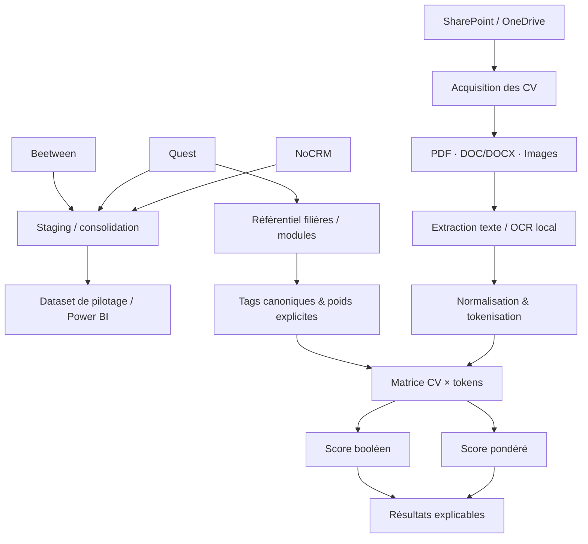

# 🧩 AJC — CV Matching & Data Consolidation

> Reconstruction publique, anonymisée et fonctionnelle d'un POC Data/NLP développé en 2023–2024 pour industrialiser le traitement de CV, construire un matching explicable par compétences et consolider plusieurs sources métier destinées au pilotage.


## 🎯 Contexte

Les équipes recrutement et formation exploitaient un volume important de CV hétérogènes ainsi que plusieurs sources métier séparées. Le besoin était double :

- **centraliser et fiabiliser les données** issues notamment de Beetween, Quest et NoCRM pour les usages Data/BI ;
- **transformer les CV en une représentation recherchable et comparable**, puis calculer des scores de rapprochement avec les filières et modules de formation.

Le POC d'origine a été utilisé sur **56 000+ CV en production**. La documentation du projet fait également état d'un vocabulaire métier ayant atteint **1 253 tokens** après le travail de tagging. Ces chiffres décrivent le système d'origine ; les données réelles ne sont évidemment pas incluses dans ce dépôt.

## 🛡️ Choix volontaire : pas de LLM ni de modèle ML

Le traitement de CV concerne des **données personnelles à fort enjeu de confidentialité dans un contexte de recrutement**. Pour cette V1, le choix a donc été de ne pas utiliser de LLM, d'embeddings ni de modèle de machine learning pour classer les profils.

Le cœur du matching repose sur des opérations déterministes et auditables :

1. normalisation du texte ;
2. tokenisation ;
3. remplacement des variantes par des tags canoniques ;
4. matrice de présence CV × compétences ;
5. score booléen ;
6. score pondéré à partir de poids explicitement définis.

Ce choix permet de savoir **pourquoi** un CV obtient un score : les tokens trouvés, absents et leurs poids sont directement visibles.

> Cette orientation réduit l'opacité algorithmique et évite d'envoyer les CV vers un fournisseur d'IA externe. Elle ne constitue toutefois pas, à elle seule, une conclusion juridique sur l'applicabilité du RGPD ou de l'AI Act : cette qualification dépend du système effectivement déployé et de son usage.

## 📌 Repères du projet d'origine

| Repère | Description |
|---|---|
| **56 000+ CV** | Documents traités dans l'usage production |
| **1 253 tokens** | État documenté du vocabulaire métier après tagging |
| **2 scores** | Matching booléen + scoring pondéré explicable |
| **3 sources métier** | Beetween, Quest et NoCRM pour la consolidation Data/BI |
| **OCR local** | Tesseract + `pdf2image`, avec conversion LibreOffice lorsque nécessaire |
| **0 LLM** | Aucun CV envoyé à un modèle génératif dans cette V1 |

## 🏗️ Architecture fonctionnelle



## 🧠 Principe du matching

### 1. Construction du vocabulaire métier

Les intitulés des filières et modules servent de matière première au référentiel. Le pipeline :

- passe les textes en majuscules ;
- retire les accents ;
- normalise les séparateurs et caractères spéciaux ;
- conserve certains tokens techniques comme `C++`, `C#` ou `.NET` ;
- retire une liste de stop words du **référentiel métier** ;
- ramène les variantes à une forme canonique (`K8S → KUBERNETES`, par exemple) ;
- associe éventuellement un poids explicite à chaque token.

### 2. Traitement des CV

Les CV suivent la même logique de normalisation, avec une particularité reprise de la V1 : les stop words ne sont pas supprimés du CV lui-même. Le filtrage est porté par le référentiel, puisque seuls ses tokens sont ensuite recherchés. Les fréquences de tokens sont conservées pour la traçabilité, mais le matching final repose volontairement sur une **matrice de présence**.

### 3. Score booléen

Pour une filière donnée :

```text
score_booléen = tokens attendus présents / nombre total de tokens attendus × 100
```

### 4. Score pondéré

Chaque token peut recevoir un poids métier explicite :

```text
score_pondéré = somme des poids des tokens présents / somme des poids attendus × 100
```

Le résultat conserve également la liste des **tokens trouvés** et **tokens absents**, ce qui rend le score directement explicable.

## 🗂️ Centralisation des sources métier

Le POC comportait aussi un volet Data destiné à rapprocher plusieurs systèmes utilisés par les équipes recrutement, formation et commerce.

La version publique fournit trois exports synthétiques ayant volontairement des schémas différents. Ils sont normalisés vers une table commune :

```text
source | entity_type | external_id | status | event_date
```

Cette partie illustre la logique qui alimentait ensuite les usages de pilotage et Power BI, sans reproduire les endpoints, identifiants ou exports de production.

## 📄 Traitement documentaire

Le module `document_processing.py` accepte :

- `.txt` / `.md` directement ;
- PDF textuels via `pypdf` ;
- PDF raster via `pdf2image` + Tesseract ;
- images via Tesseract ;
- DOC/DOCX/ODT/RTF via conversion LibreOffice en PDF, puis extraction ou OCR.

Tout le traitement est **local**. Aucun document n'est envoyé vers un service d'IA.

## 🚀 Démonstration locale

Créer un environnement :

```bash
python -m venv .venv
source .venv/bin/activate
pip install -r requirements.txt
```

Lancer le démonstrateur synthétique :

```bash
PYTHONPATH=src python -m ajc_cv_matching demo --reset
```

Les résultats sont écrits dans :

```text
runtime/
├── ajc_demo.db
├── staging/business_events.csv
└── results/
    ├── boolean_matrix.csv
    ├── matching_results.csv
    └── tokens/
```

Le démonstrateur conserve les noms `Candidate_00X` uniquement parce qu’ils sont synthétiques. La commande `match` destinée à des documents locaux utilise par défaut un **identifiant SHA-256 tronqué** au lieu du nom de fichier afin de limiter la propagation de données nominatives dans les sorties.

Le jeu de démonstration contient trois CV **entièrement fictifs** : Data, DevOps et développement logiciel.

## 🐳 Docker

Le dépôt propose trois images publiques reconstruites à partir des responsabilités et dépendances observées dans la V1 :

- `Dockerfile.pipeline` : consolidation locale + NLP + matching ;
- `Dockerfile.ocr` : même base avec Tesseract, Poppler et LibreOffice pour les documents multi-formats ;
- `Dockerfile.sources` : connecteurs distants optionnels et consolidation des exports métier.

Lancer la démonstration principale :

```bash
docker compose run --rm demo
```

Le service de démonstration s'exécute sans réseau (`network_mode: none`) afin de souligner le caractère local du traitement.

### 🔌 Connecteurs distants optionnels

Les connecteurs historiques contenaient des paramètres d'accès directement dans les scripts. Dans cette reconstruction, **aucun secret n'est codé en dur** : la configuration passe par des variables d'environnement.

Pour préparer un environnement local :

```bash
cp .env.example .env
```

Les variables disponibles couvrent notamment :

- URL(s) d'export Quest ;
- URL et clé API NoCRM ;
- URL et Bearer token Beetween ;
- credentials Microsoft Graph / OneDrive ;
- allow-list explicite des domaines distants autorisés.

Le profil distant est désactivé par défaut :

```bash
docker compose --profile remote run --rm source-sync
```

Les téléchargements refusent HTTP non chiffré, les redirections et les domaines non présents dans `AJC_ALLOWED_REMOTE_HOSTS`. Le dépôt ne fournit volontairement **aucun endpoint ni identifiant de production**.

## 🧪 Tests et contrôle avant publication

```bash
PYTHONPATH=src pytest -q
python -m compileall -q src tests scripts
python scripts/public_release_check.py
```

Le dernier contrôle recherche notamment :

- JWT/Bearer tokens ;
- chemins utilisateurs historiques ;
- emails internes ;
- anciennes URLs d'exports ;
- traces de tenants ou endpoints privés.

## 🧭 Correspondance avec la V1 historique

Les noms des scripts de production ont volontairement été remplacés par des modules lisibles et importables. Une table de correspondance est disponible dans [`docs/original-v1-mapping.md`](docs/original-v1-mapping.md).

Le code public **n'est pas la V2 confidentielle** et ne contient pas non plus un dump des scripts historiques. Il s'agit d'une reconstruction propre du fonctionnement V1, réalisée à partir du POC fourni pour cette publication.

## 📁 Structure du dépôt

```text
.
├── src/ajc_cv_matching/
│   ├── cli.py
│   ├── config.py
│   ├── document_processing.py
│   ├── normalization.py
│   ├── pipeline.py
│   ├── reference.py
│   ├── scoring.py
│   └── sources/
│       └── consolidation.py
├── examples/
│   ├── cv/
│   ├── reference/
│   └── source_exports/
├── tests/
├── scripts/
├── docker/
├── requirements/
├── runtime/
├── docker-compose.yml
├── PRIVACY.md
├── SECURITY.md
└── README.md
```

## 🔐 Confidentialité

Ce dépôt ne contient **aucun CV réel**, aucun nom de candidat ou formateur, aucun résultat nominatif, aucune base SQLite de production, aucun fichier Power BI, aucun export métier réel, aucun token, aucune clé API, aucun identifiant Microsoft Graph, aucune configuration SSH et aucune adresse interne.

Les données de `examples/` ont été créées uniquement pour le dépôt public.

Voir [`PRIVACY.md`](PRIVACY.md) et [`SECURITY.md`](SECURITY.md).

## ⚠️ Usage

Ce projet est présenté comme **portfolio technique et démonstrateur**. Il ne doit pas être utilisé tel quel pour prendre des décisions de recrutement réelles. Tout usage sur des données personnelles nécessite sa propre analyse juridique, sécurité, gouvernance, information des personnes, règles de conservation et contrôle humain adaptés au contexte.

## 🧰 Stack

Python · pandas · NumPy · SQLAlchemy · SQLite · Unidecode · Tesseract OCR · Pillow · pdf2image · pypdf · LibreOffice · Docker · Docker Compose · Power BI (contexte de restitution)

## 📜 Licence

Aucune licence Open Source n'est accordée implicitement. Sauf ajout ultérieur d'un fichier `LICENSE`, tous droits réservés.
